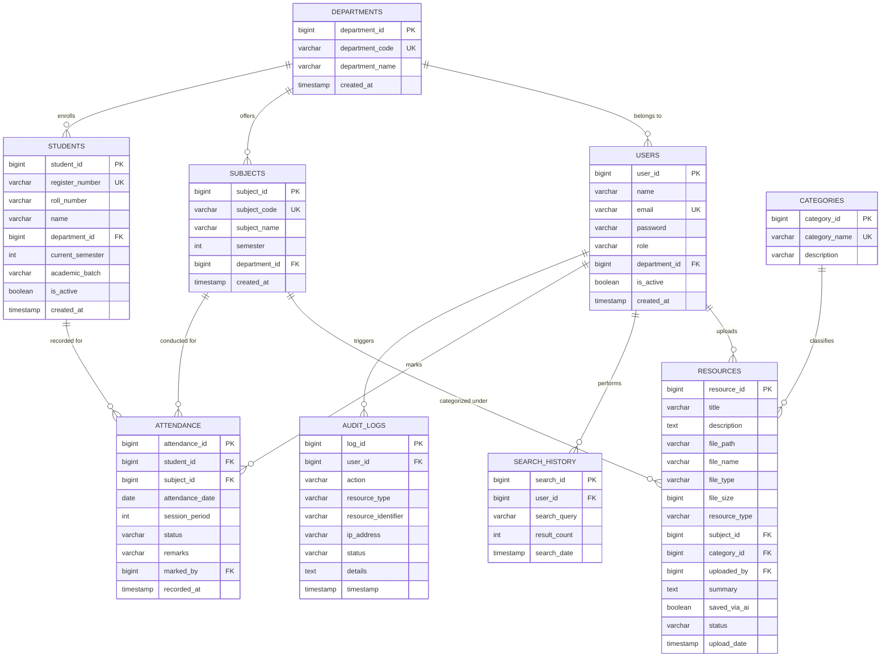
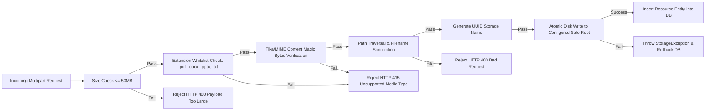
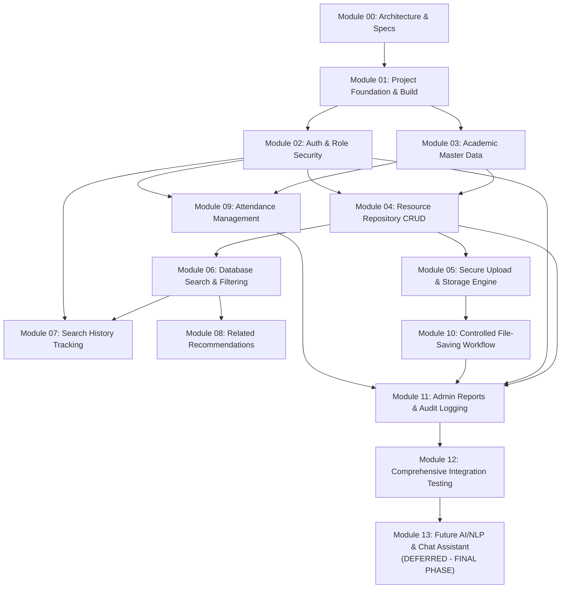

# AI-Based College Resource Finder: System Architecture & Requirements Specification
**Document Version:** 1.0.0  
**Project:** MCA Mini-Project — Vinush S (Reg No: 26MCA091)  
**Institution:** Hindusthan College of Arts & Science (Autonomous), Coimbatore  
**Target Environment:** Local Windows 10/11 (Java 21, Spring Boot 3.x, MySQL 8.x, Vanilla JS / Bootstrap 5)  
**Module Phase:** Module 00 (Architecture, Design, & System Specification)

---

## 1. Project Understanding and Objectives

### 1.1 Context and Problem Statement
In higher education institutions, essential academic assets—lecture notes, past question papers, assignments, lab manuals, and syllabus copies—are conventionally dispersed across heterogeneous file systems, local departmental computers, shared Google Drives, and ad-hoc communication channels (e.g., WhatsApp, Telegram). This fragmentation introduces severe information bottlenecks:
- **High Search Latency:** Students spend disproportionate time hunting for specific materials without certainty of version or syllabus relevance.
- **Keyword Rigidity:** Traditional folder traversal requires knowing exact folder paths and file naming conventions.
- **Administrative Friction:** Faculty members lack a unified, secure platform to organize, classify, update, and monitor resource dissemination.
- **Fragmented Academic Workflows:** Routine academic activities such as checking subject-wise attendance and archiving curriculum resources require navigating separate, disconnected portals.

### 1.2 Primary System Objectives
1. **Unified Academic Repository:** Provide a centralized, hierarchical catalog (Department $\rightarrow$ Semester $\rightarrow$ Subject $\rightarrow$ Category $\rightarrow$ Resource) accessible through standard web browsers.
2. **Robust Multi-Role Security:** Enforce strict Role-Based Access Control (RBAC) across three distinct actors: `STUDENT`, `FACULTY` (Staff), and `ADMINISTRATOR`.
3. **High-Performance Core Operations:** Deliver deterministic, database-backed search, faceted filtering, chronological search tracking, and related-material recommendations prior to any AI integration.
4. **Academic Workflow Integration:** Implement a subject-wise attendance tracking module and a controlled file-saving engine with transaction-safe metadata recording.
5. **Decoupled AI-Ready Architecture:** Design standard REST endpoints and clean abstraction boundaries so that natural-language intent parsing, document summarization, and vector search (Python/FastAPI) can be plugged in seamlessly in the final development phase without rewriting core business services.
6. **Zero-Cloud, Zero-Docker Local Deployment:** Run fully locally on Windows 10/11 using standard runtime environments (JDK 21, MySQL 8.x Community Server, Maven 3.9+).

---

## 2. Functional and Non-Functional Requirements

### 2.1 Functional Requirements (FR)
- **FR-01: Identity & Access Management (IAM)**
  - Registration with department assignment.
  - Authentication with BCrypt-hashed password verification.
  - Role-based route and API method protection (`ROLE_STUDENT`, `ROLE_FACULTY`, `ROLE_ADMIN`).
  - Session/token invalidation upon logout.
- **FR-02: Academic Master Data Management**
  - Department maintenance (ID, code, name).
  - Subject cataloging mapped to specific departments and semesters (1 to 8).
  - Resource categorization (e.g., *Notes*, *Question Papers*, *Assignments*, *E-Books*).
- **FR-03: Resource Repository & Metadata Management**
  - Faculty/Admin resource creation: title, description, subject, category, resource type.
  - Resource update and soft/hard deletion with ownership validation.
  - Resource status tracking (`ACTIVE`, `ARCHIVED`).
- **FR-04: Secure Upload & Streaming Engine**
  - Validation of file extension and MIME type against an strict allowlist (PDF, DOCX, PPTX, TXT).
  - Storage path sanitization preventing directory traversal (`../`).
  - Secure download and in-browser preview endpoints protected by role checks.
- **FR-05: Database Search & Faceted Filtering**
  - Search query matching across resource title, description, subject name, and department.
  - Multi-attribute filtering by department ID, semester, subject ID, and category ID.
  - Empty-query validation and graceful "No resources found" handling.
- **FR-06: Search History Tracking**
  - Automatic logging of user search queries with exact timestamps.
  - Chronological history retrieval per user.
  - Capability to re-execute past searches with a single click.
- **FR-07: Contextual Recommendations**
  - Automated suggestion of related resources belonging to the same subject, semester, or category.
  - Ranking based on co-occurrence and recent popularity.
- **FR-08: Attendance Management Subsystem**
  - Student directory management with unique register numbers (e.g., `26MCA091`).
  - Subject-wise daily attendance marking (`PRESENT`, `ABSENT`) by authorized faculty.
  - Attendance summary and percentage calculations ($Percentage = \frac{Attended Sessions}{Total Recorded Sessions} \times 100$).
  - Student privacy isolation: Students may only view their own attendance records.
- **FR-09: Controlled File-Saving Workflow**
  - Directed file archiving workflow where staff/admin provide a file and target academic metadata.
  - Automatic directory resolution and collision-free file naming.
  - Atomic database record creation tied to physical file persistence.
- **FR-10: Administrative Analytics & Audit Logging**
  - Inventory reports: user distribution, resources per department/semester, storage utilization.
  - Audit log table recording critical system actions (logins, file uploads, deletions, attendance modifications, unauthorized access attempts).
- **FR-11: Future AI Integration Contracts**
  - REST request/response contracts for future query-intent parsing, document summarization, and conversational resource retrieval.

### 2.2 Non-Functional Requirements (NFR)
- **NFR-01: Performance & Latency:** Metadata queries and search lookups must execute within $\le 150\text{ ms}$ under local database load. File download initiation must occur within $\le 500\text{ ms}$.
- **NFR-02: Security & Data Integrity:**
  - Passwords hashed using BCrypt (work factor 12).
  - All SQL queries executed via JPA Parameterized Queries or Hibernate Criteria API (zero dynamic string concatenation).
  - Server-side role authorization on every single `/api/v1/*` endpoint.
  - Uploaded files stored outside the web server's execution root to prevent remote code execution.
- **NFR-03: Reliability & Atomicity:** Database operations and file writes must be transaction-safe. If a file cannot be written to disk, the database transaction must roll back, leaving no orphaned records or untracked physical files.
- **NFR-04: Maintainability & Modularity:** Clean 3-tier architecture (Controller $\rightarrow$ Service $\rightarrow$ Repository) with Flyway-managed schema migrations.
- **NFR-05: Portability:** Compatible out-of-the-box with Windows 10/11 64-bit systems without requiring Docker or cloud daemons.

---

## 3. Feature Checklist Mapped to Report

| Report Feature / Module | Report Section | Proposed Core Module | Implementation Priority | Status |
| :--- | :--- | :--- | :--- | :--- |
| **User Authentication & RBAC** | Sec 3.2.1 (6, 7), 4.5.1 | Module 02 | High | Planned (Core) |
| **Department & Subject Master Data** | Sec 4.3 (Tables 2, 3) | Module 03 | High | Planned (Core) |
| **Category Management** | Sec 4.3 (Table 5) | Module 03 | High | Planned (Core) |
| **Resource Repository (CRUD)** | Sec 3.2.1 (8), 4.5.4 | Module 04 | High | Planned (Core) |
| **Secure File Upload & Storage** | Sec 4.4 (Table 4), 5.2.4 | Module 05 | High | Planned (Core) |
| **Secure Download & Viewing** | Sec 3.2.1 (9), 4.5.5 | Module 05 | High | Planned (Core) |
| **Database-Backed Search** | Sec 4.5.3, Appendix (3) | Module 06 | High | Planned (Core) |
| **Search Query History** | Sec 3.2.1 (10), 4.3 (Table 6) | Module 07 | Medium | Planned (Core) |
| **Related Resource Recommendations**| Sec 3.2.1 (11), 4.5.7 | Module 08 | Medium | Planned (Core) |
| **Student Directory & Attendance** | Sec 4.3 (Tables 7, 8), 4.5.11| Module 09 | High | Planned (Core) |
| **Controlled File-Saving Workflow** | Sec 3.2.1 (19), 4.5.13 | Module 10 | Medium | Planned (Core) |
| **Admin Reports & Security Audit** | Sec 4.4 (Outputs 7,8,9), 5.2.5 | Module 11 | High | Planned (Core) |
| **Unit & Integration Test Suite** | Chapter 5, TC_01 to TC_10 | Module 12 | High | Planned (Core) |
| **AI Query Processing & Chatbot** | Sec 3.2.1 (1, 15), 4.5.2 | Module 13 | Deferred | Deferred (AI Phase) |
| **Direct Download Links via AI** | Sec 3.2.1 (16), 4.5.9 | Module 13 | Deferred | Deferred (AI Phase) |
| **AI Document Summarization** | Sec 3.2.1 (18), 4.5.12 | Module 13 | Deferred | Deferred (AI Phase) |

---

## 4. Student, Faculty/Staff, and Administrator Roles

```mermaid
graph TD
    classDef admin fill:#f96,stroke:#333,stroke-width:2px;
    classDef faculty fill:#69f,stroke:#333,stroke-width:2px;
    classDef student fill:#6f9,stroke:#333,stroke-width:2px;

    User((User Account)) --> Admin[ROLE_ADMIN]:::admin
    User --> Faculty[ROLE_FACULTY / Staff]:::faculty
    User --> Student[ROLE_STUDENT]:::student

    Admin --> A1[Manage Users & Roles]
    Admin --> A2[Manage Departments & Subjects]
    Admin --> A3[System Audit Logs & Reports]
    Admin --> A4[Full Resource Governance]
    Admin --> A5[Attendance Oversight]

    Faculty --> F1[Upload Academic Resources]
    Faculty --> F2[Manage Own Uploaded Resources]
    Faculty --> F3[Mark & Edit Subject Attendance]
    Faculty --> F4[View Class Attendance Reports]
    Faculty --> F5[Execute Controlled File Saving]

    Student --> S1[Search Resources by Keyword/Filter]
    Student --> S2[View Metadata & Download Files]
    Student --> S3[View Own Search History]
    Student --> S4[View Own Attendance & Percentage]
    Student --> S5[Receive Recommendations]
```



### 4.1 Role Detailed Permissions
- **ROLE_STUDENT:**
  - May authenticate and manage personal profile.
  - May search and filter approved academic materials.
  - May download study materials, question papers, notes, and e-books.
  - May view personal search history and clear own history.
  - May view **strictly personal** attendance records and percentage calculations.
  - *Forbidden:* Uploading resources, editing subjects, viewing other students' attendance, accessing system audit logs.
- **ROLE_FACULTY (Staff):**
  - May perform all Student read/search capabilities.
  - May upload new resources with full academic taxonomy tags.
  - May edit and delete resources uploaded by their own account.
  - May execute controlled file-saving workflows.
  - May mark, update, and search subject-wise attendance for assigned department/subjects.
  - May generate student attendance sheets and percentage statistics.
  - *Forbidden:* Deleting other faculty members' files (unless Admin), managing department master data, modifying user roles.
- **ROLE_ADMIN:**
  - Superuser privileges across the platform.
  - May create, modify, deactivate users, and assign roles (`STUDENT`, `FACULTY`, `ADMIN`).
  - May configure Departments, Subjects, Semesters, and Categories.
  - May inspect, moderate, re-classify, or delete any resource repository record and physical file.
  - May view complete system metrics, resource distribution charts, and security audit logs.
  - May override or audit attendance records.

---

## 5. Architecture Diagram and Component Responsibilities

### 5.1 System Component Architecture
```mermaid
flowchart TD
    subgraph Client Tier ["Client Tier (Browser)"]
        UI["Bootstrap 5 + Vanilla ES6 JS UI"]
        Forms["Input Forms & File Uploader"]
        Tables["Data Tables & Search View"]
    end

    subgraph Security Layer ["Security & Interception Layer"]
        AuthFilter["Spring Security Filter Chain"]
        JWT_Session["Session / Token Authenticator"]
        CORS["CORS & CSRF Handler"]
        AuditInterceptor["Audit & Access Logger"]
    end

    subgraph Controller Tier ["Spring Boot Web Tier (/api/v1)"]
        AuthController["AuthController"]
        MasterDataController["Department & Subject Controller"]
        ResourceController["ResourceController"]
        SearchController["Search & Recommendation Controller"]
        AttendanceController["AttendanceController"]
        AdminController["Admin & Report Controller"]
        AIInterfaceController["Future AI Contract Stubs"]
    end

    subgraph Service Tier ["Business Logic Tier"]
        AuthService["Auth & User Service"]
        ResourceService["Resource Service"]
        StorageService["Local Disk Storage Engine"]
        SearchService["Search & History Service"]
        AttendanceService["Attendance Calculation Engine"]
        AuditService["Audit Log Service"]
    end

    subgraph Data Access Tier ["Data Persistence Tier"]
        JPA["Spring Data JPA / Hibernate ORM"]
        Flyway["Flyway Migration Engine"]
    end

    subgraph Storage Tier ["Physical Storage Tier"]
        MySQL[("MySQL 8.x Database")]
        FileStore[("Protected Windows File Storage\n(e.g., C:/college_resource_finder/storage)")]
    end

    subgraph Future AI Tier ["Future Integration (Phase 2 - Deferred)"]
        FastAPIStub["FastAPI Service (Python / Uvicorn)\n[NLP / Embeddings / Summarization]"]
    end

    Client Tier -->|HTTP/HTTPS REST| Security Layer
    Security Layer --> Controller Tier
    Controller Tier --> Service Tier
    Service Tier --> Data Access Tier
    Service Tier -->|Sanitized I/O| FileStore
    DataAccessTier --> Flyway
    Flyway --> MySQL
    JPA --> MySQL
    Service Tier -.->|HTTP JSON Contract (Future)| FastAPIStub
```

### 5.2 Component Responsibilities
1. **Frontend Presentation (Client Tier):** Clean, accessible HTML5 templates, styled with Bootstrap 5. Pure ES6 JavaScript handles asynchronous `fetch` calls to `/api/v1`, DOM updates, file upload progress, and validation feedback.
2. **Security & Interception Layer:** Enforces authentication on all non-public routes, verifies user roles via Spring Security, logs unauthorized access attempts, and sanitizes input headers.
3. **Controller Tier (`/api/v1`):** Validates incoming DTOs (`@Valid`), delegates to service components, and produces standardized JSON responses (`ApiResponse<T>`).
4. **Service Tier:** Encapsulates business logic, transactional boundaries (`@Transactional`), business validation rules, file checksum calculations, and attendance percentage computations.
5. **Storage Service:** Manages disk storage under a secure, non-public directory. Implements UUID file renaming, directory sharding (`/{dept}/{semester}/{subject}/`), MIME validation, and atomic rollbacks upon failure.
6. **Data Persistence Tier:** Spring Data JPA repositories with custom queries, indexing, and Flyway migration scripts guaranteeing reproducible schema setup.
7. **Future AI Tier (Deferred):** Outlined exclusively as an external REST consumer/provider. The core application provides query webhooks and document text extractors, remaining 100% operational whether the AI service is online or offline.

---

## 6. Database ER Diagram with Entities, Attributes, and Relationships



---

## 7. Database Normalization, Integrity Constraints, and Attendance Gap Analysis

### 7.1 Normalization Analysis (1NF, 2NF, 3NF)
- **First Normal Form (1NF):** All tables store atomic values. Repeating groups and multi-valued fields (e.g. combined subjects, multiple file paths) are completely eliminated. Every table has an explicit synthetic Primary Key (`BIGINT AUTO_INCREMENT`).
- **Second Normal Form (2NF):** Every non-key attribute is fully functionally dependent on the entire primary key. No partial dependencies exist.
- **Third Normal Form (3NF):** Transitive dependencies have been eliminated. For example, `department_name` is not duplicated in `USERS`, `SUBJECTS`, or `STUDENTS`; instead, each references `department_id`.

### 7.2 Missing Attendance Requirements & Provisional Model
#### Gaps Identified in Original Report:
1. **Multiple Daily Sessions/Periods:** The report only defined `(attendance_date, status, student_id, subject_id)`. In practical college timetables, a subject may have morning and afternoon sessions, or multiple periods per day.
2. **Subject Enrollment vs. Semester Grouping:** In colleges, students attend classes based on their active semester and department. Without an enrollment link or session distinction, duplicate records or unmapped students can corrupt percentage metrics.
3. **Session Cancellation & Remarks:** Absence reasons (e.g., Medical Leave, On-Duty, Lab Practical) and cancelled sessions were unrepresented.

#### Provisional Solution Incorporated:
- Added `session_period` (`INT`, default 1) to distinguish multiple periods on the same date.
- Added composite unique constraint: `UNIQUE KEY uk_attendance_session (student_id, subject_id, attendance_date, session_period)`. This strictly prevents double-marking the same student in the same class hour.
- Added `academic_batch` (e.g., "2025-2027") and `current_semester` in `STUDENTS`.
- Added `remarks` (`VARCHAR(255)`) to record excused leaves or lab sessions.
- Calculated metrics:
  $$\text{Total Sessions} = \text{COUNT(attendance\_id)}$$
  $$\text{Attended Sessions} = \text{COUNT(attendance\_id) WHERE status = 'PRESENT'}$$
  $$\text{Attendance Percentage} = \left(\frac{\text{Attended Sessions}}{\text{Total Sessions}}\right) \times 100$$

### 7.3 Integrity Constraints Summary
- **Foreign Key Cascades:**
  - Master data (`departments`, `subjects`, `categories`) use `ON DELETE RESTRICT` to protect referential integrity.
  - User activity data (`search_history`, `audit_logs`) use `ON DELETE CASCADE` or `SET NULL` on user deletion depending on retention compliance.
- **Indexes for High-Performance Queries:**
  - `idx_resources_search`: Full-text/B-Tree index on `(title, description)`.
  - `idx_resources_filter`: Composite index on `(subject_id, category_id, status)`.
  - `idx_attendance_lookup`: Composite index on `(student_id, subject_id, attendance_date)`.
  - `idx_history_user`: Index on `(user_id, search_date DESC)`.

---

## 8. REST API Plan under `/api/v1`

### 8.1 Authentication & Profile (`/api/v1/auth`)
| Method | Endpoint | Request Body / Params | Role Required | Description |
| :--- | :--- | :--- | :--- | :--- |
| `POST` | `/api/v1/auth/register` | `RegisterRequestDto` | Public | Register new student or faculty account |
| `POST` | `/api/v1/auth/login` | `LoginRequestDto` | Public | Authenticate user, return session/token & profile |
| `POST` | `/api/v1/auth/logout` | None | Authenticated | Invalidate active session or token |
| `GET` | `/api/v1/auth/me` | None | Authenticated | Retrieve current user profile and role |

### 8.2 Academic Master Data (`/api/v1/master`)
| Method | Endpoint | Request Body / Params | Role Required | Description |
| :--- | :--- | :--- | :--- | :--- |
| `GET` | `/api/v1/master/departments` | None | Authenticated | List all active departments |
| `POST` | `/api/v1/master/departments` | `DepartmentDto` | `ROLE_ADMIN` | Create new department |
| `GET` | `/api/v1/master/departments/{deptId}/subjects`| `?semester={sem}` | Authenticated | List subjects for a department/semester |
| `POST` | `/api/v1/master/subjects` | `SubjectDto` | `ROLE_ADMIN` | Create new subject mapping |
| `GET` | `/api/v1/master/categories` | None | Authenticated | List all resource categories |
| `POST` | `/api/v1/master/categories` | `CategoryDto` | `ROLE_ADMIN` | Add new resource category |

### 8.3 Resource Repository & File Engine (`/api/v1/resources`)
| Method | Endpoint | Request Body / Params | Role Required | Description |
| :--- | :--- | :--- | :--- | :--- |
| `POST` | `/api/v1/resources/upload` | `multipart/form-data` + metadata | `ROLE_FACULTY`, `ROLE_ADMIN` | Validate & upload academic resource file |
| `GET` | `/api/v1/resources/{id}` | Path variable | Authenticated | Get resource metadata |
| `GET` | `/api/v1/resources/{id}/download` | Path variable | Authenticated | Securely stream/download physical file |
| `GET` | `/api/v1/resources/{id}/preview` | Path variable | Authenticated | Stream inline preview (PDF/images) |
| `PUT` | `/api/v1/resources/{id}` | `ResourceUpdateDto` | `ROLE_FACULTY` (owner), `ROLE_ADMIN` | Update resource title/description/category |
| `DELETE` | `/api/v1/resources/{id}` | Path variable | `ROLE_FACULTY` (owner), `ROLE_ADMIN` | Soft delete or archive resource |

### 8.4 Search, Discovery & Recommendations (`/api/v1/search`)
| Method | Endpoint | Request Body / Params | Role Required | Description |
| :--- | :--- | :--- | :--- | :--- |
| `GET` | `/api/v1/search` | `?query=...&deptId=...&sem=...&cat=...` | Authenticated | Database search with keyword & faceted filters |
| `GET` | `/api/v1/search/recommendations` | `?resourceId=...` or `?subjectId=...` | Authenticated | Retrieve related resource recommendations |
| `GET` | `/api/v1/search/history` | `?page=0&size=10` | Authenticated | Retrieve logged user search history |
| `DELETE` | `/api/v1/search/history` | None | Authenticated | Clear user's personal search history |

### 8.5 Attendance Management (`/api/v1/attendance`)
| Method | Endpoint | Request Body / Params | Role Required | Description |
| :--- | :--- | :--- | :--- | :--- |
| `GET` | `/api/v1/attendance/students` | `?deptId=...&semester=...` | `ROLE_FACULTY`, `ROLE_ADMIN` | Fetch student roster for attendance entry |
| `POST` | `/api/v1/attendance/mark-batch` | `AttendanceBatchDto` | `ROLE_FACULTY`, `ROLE_ADMIN` | Submit class attendance record for a date/session |
| `GET` | `/api/v1/attendance/student/{regNo}` | `?startDate=...&endDate=...` | Authenticated (Self or Staff/Admin) | Get subject-wise attendance & percentage |
| `GET` | `/api/v1/attendance/subject-summary` | `?subjectId=...&semester=...` | `ROLE_FACULTY`, `ROLE_ADMIN` | Subject-level attendance percentage sheet |

### 8.6 Controlled File-Saving Workflow (`/api/v1/files/controlled-save`)
| Method | Endpoint | Request Body / Params | Role Required | Description |
| :--- | :--- | :--- | :--- | :--- |
| `POST` | `/api/v1/files/controlled-save` | `multipart/form-data` + target tags | `ROLE_FACULTY`, `ROLE_ADMIN` | Store file in designated folder & record metadata |

### 8.7 Administration, Metrics & Audit (`/api/v1/admin`)
| Method | Endpoint | Request Body / Params | Role Required | Description |
| :--- | :--- | :--- | :--- | :--- |
| `GET` | `/api/v1/admin/users` | `?role=...&page=...` | `ROLE_ADMIN` | List and manage user accounts |
| `PATCH` | `/api/v1/admin/users/{id}/status` | `{ "isActive": false }` | `ROLE_ADMIN` | Enable / disable user accounts |
| `GET` | `/api/v1/admin/reports/inventory` | None | `ROLE_ADMIN` | Department & subject resource distribution |
| `GET` | `/api/v1/admin/audit-logs` | `?action=...&page=...` | `ROLE_ADMIN` | Paginated security and transaction audit logs |

### 8.8 Future AI Service Contracts (Stubs / Specifications Only)
| Method | Endpoint | Request Body / Params | Role Required | Description |
| :--- | :--- | :--- | :--- | :--- |
| `POST` | `/api/v1/ai/interfaces/parse-intent` | `{"query": "Find DBMS Unit 3 notes"}` | Internal / Auth | Contract for future NLP intent & entity extraction |
| `POST` | `/api/v1/ai/interfaces/summarize` | `{"resourceId": 101}` | `ROLE_FACULTY`, `ROLE_ADMIN` | Contract for future text document summarization |
| `POST` | `/api/v1/ai/interfaces/chat` | `{"message": "..."}` | Authenticated | Contract for future conversational assistant |

---

## 9. Role-Permission Matrix

| Action / Capability | Anonymous | ROLE_STUDENT | ROLE_FACULTY | ROLE_ADMIN |
| :--- | :---: | :---: | :---: | :---: |
| **View Login / Register Pages** | ✅ | ✅ | ✅ | ✅ |
| **Authenticate / Receive Token** | ✅ | ✅ | ✅ | ✅ |
| **Search Academic Resources** | ❌ | ✅ | ✅ | ✅ |
| **View Resource Metadata** | ❌ | ✅ | ✅ | ✅ |
| **Download / Preview Resource File** | ❌ | ✅ | ✅ | ✅ |
| **View Personal Search History** | ❌ | ✅ | ✅ | ✅ |
| **Clear Personal Search History** | ❌ | ✅ | ✅ | ✅ |
| **View Related Recommendations** | ❌ | ✅ | ✅ | ✅ |
| **View Own Attendance & Percentage** | ❌ | ✅ | ✅ | ✅ |
| **View Other Students' Attendance** | ❌ | ❌ | ✅ | ✅ |
| **Mark / Edit Daily Attendance** | ❌ | ❌ | ✅ | ✅ |
| **Upload New Academic Resource** | ❌ | ❌ | ✅ | ✅ |
| **Edit / Delete Own Uploaded Resource**| ❌ | ❌ | ✅ | ✅ |
| **Edit / Delete Any Resource** | ❌ | ❌ | ❌ | ✅ |
| **Controlled File-Saving Execution** | ❌ | ❌ | ✅ | ✅ |
| **Create Departments / Subjects** | ❌ | ❌ | ❌ | ✅ |
| **Manage User Status & Roles** | ❌ | ❌ | ❌ | ✅ |
| **View System Audit Logs** | ❌ | ❌ | ❌ | ✅ |
| **Generate Master Admin Reports** | ❌ | ❌ | ❌ | ✅ |

---

## 10. Security and File-Storage Strategy

### 10.1 File Upload Validation Pipeline


### 10.2 Storage Isolation Strategy
- **Physical Separation:** Files are saved to a directory completely outside the static web server root (configured via `app.storage.upload-dir=C:/college_resource_finder/storage/`). Under no circumstances is this directory directly exposed over HTTP.
- **Collision-Free Storage Naming:** Files are renamed upon arrival using `UUID.randomUUID().toString() + "_" + sanitizedOriginalName`. The original filename is preserved in the database metadata for download presentation.
- **Controlled Streaming:** Downloads pass through `/api/v1/resources/{id}/download`. The controller reads the user's principal, verifies resource status, logs the download audit record, and streams the file using Spring's `ResourceRegion` or `InputStreamResource` with appropriate `Content-Disposition: attachment; filename="..."` headers.

### 10.3 Password and Session Security
- **Hashing:** Passwords hashed with BCrypt (12 rounds). Raw passwords never written to logs or database.
- **Spring Security Filter Chain:** Stateless or HTTP-only cookie-based authentication, CSRF protection, and standardized HTTP 401/403 handlers returning consistent JSON error payloads.

---

## 11. Project Folder Structure

```
ai_basced_college_resource_finder/
├── .gitignore
├── pom.xml                                   # Maven project descriptor
├── README.md                                 # Windows execution & project instructions
├── docs/                                     # Architecture diagrams & API documentation
│   └── architecture_spec.md
├── src/
│   ├── main/
│   │   ├── java/
│   │   │   └── com/
│   │   │       └── college/
│   │   │           └── resourcefinder/
│   │   │               ├── ResourceFinderApplication.java
│   │   │               ├── config/           # Security, WebMvc, Storage configuration
│   │   │               │   ├── SecurityConfig.java
│   │   │               │   ├── WebMvcConfig.java
│   │   │               │   └── StorageProperties.java
│   │   │               ├── controller/       # REST Controllers under /api/v1
│   │   │               │   ├── AuthController.java
│   │   │               │   ├── MasterDataController.java
│   │   │               │   ├── ResourceController.java
│   │   │               │   ├── SearchController.java
│   │   │               │   ├── AttendanceController.java
│   │   │               │   ├── ControlledFileController.java
│   │   │               │   ├── AdminController.java
│   │   │               │   └── FutureAIContractController.java
│   │   │               ├── dto/              # Request / Response Transfer Objects
│   │   │               │   ├── request/
│   │   │               │   └── response/
│   │   │               ├── entity/           # JPA Entities
│   │   │               │   ├── User.java
│   │   │               │   ├── Department.java
│   │   │               │   ├── Subject.java
│   │   │               │   ├── Category.java
│   │   │               │   ├── Resource.java
│   │   │               │   ├── SearchHistory.java
│   │   │               │   ├── Student.java
│   │   │               │   ├── Attendance.java
│   │   │               │   └── AuditLog.java
│   │   │               ├── exception/        # Global Exception Handler & Custom Exceptions
│   │   │               │   ├── GlobalExceptionHandler.java
│   │   │               │   ├── ResourceNotFoundException.java
│   │   │               │   └── StorageException.java
│   │   │               ├── repository/       # Spring Data JPA Repositories
│   │   │               │   ├── UserRepository.java
│   │   │               │   ├── DepartmentRepository.java
│   │   │               │   ├── SubjectRepository.java
│   │   │               │   ├── CategoryRepository.java
│   │   │               │   ├── ResourceRepository.java
│   │   │               │   ├── SearchHistoryRepository.java
│   │   │               │   ├── StudentRepository.java
│   │   │               │   ├── AttendanceRepository.java
│   │   │               │   └── AuditLogRepository.java
│   │   │               ├── service/          # Service Interfaces & Implementations
│   │   │               │   ├── AuthService.java
│   │   │               │   ├── MasterDataService.java
│   │   │               │   ├── ResourceService.java
│   │   │               │   ├── StorageService.java
│   │   │               │   ├── SearchService.java
│   │   │               │   ├── AttendanceService.java
│   │   │               │   ├── ControlledFileService.java
│   │   │               │   └── AuditService.java
│   │   │               └── util/             # File, Path, & Security utilities
│   │   │                   ├── FileValidator.java
│   │   │                   └── SecurityUtils.java
│   │   └── resources/
│   │       ├── application.properties        # Default Spring configuration
│   │       ├── application-dev.properties    # Local development overrides
│   │       ├── db/
│   │       │   └── migration/                # Flyway SQL migrations
│   │       │       ├── V1__init_schema.sql
│   │       │       ├── V2__seed_master_data.sql
│   │       │       └── V3__attendance_and_audit.sql
│   │       └── static/                       # Frontend SPA / MPUI Assets
│   │           ├── index.html                # Main portal / dashboard
│   │           ├── login.html                # Authentication view
│   │           ├── search.html               # Resource discovery view
│   │           ├── upload.html               # Faculty upload & file saving view
│   │           ├── attendance.html           # Attendance tracking view
│   │           ├── admin.html                # Admin reports & user governance
│   │           ├── css/
│   │           │   ├── bootstrap.min.css
│   │           │   └── custom.css
│   │           └── js/
│   │               ├── api.js                # Reusable fetch client
│   │               ├── auth.js               # Auth state & route guards
│   │               ├── search.js             # Search & recommendations
│   │               ├── upload.js             # Upload handlers & progress
│   │               ├── attendance.js         # Attendance calculation & tables
│   │               └── admin.js              # Admin charts & logs
│   └── test/
│       └── java/
│           └── com/
│               └── college/
│                   └── resourcefinder/
│                       ├── controller/       # MockMvc Web Layer Tests
│                       ├── service/          # Unit Tests with Mockito
│                       └── integration/      # End-to-End Integration Tests
```

---

## 12. Windows Development and Startup Plan

### 12.1 Prerequisites Verification
1. **Operating System:** Windows 10 or 11 (64-bit).
2. **Java Development Kit (JDK):** OpenJDK or Oracle JDK 21 LTS installed. Verify in PowerShell:
   ```powershell
   java -version
   ```
3. **Build Tool:** Apache Maven 3.9+. Verify:
   ```powershell
   mvn -version
   ```
4. **Database Engine:** MySQL 8.0 Community Server installed and running as a Windows Service (`MySQL80`). Verify:
   ```powershell
   mysql -u root -p -e "SELECT VERSION();"
   ```

### 12.2 Database Setup
Execute in MySQL Command Line Client or MySQL Workbench:
```sql
CREATE DATABASE IF NOT EXISTS college_resource_finder 
CHARACTER SET utf8mb4 COLLATE utf8mb4_unicode_ci;
```

### 12.3 Storage Directory Setup
Create a dedicated local folder on Windows for managed file storage:
```powershell
New-Item -ItemType Directory -Force -Path "C:\college_resource_finder\storage"
```

### 12.4 Build and Startup Execution
In PowerShell within the project workspace directory:
```powershell
# 1. Clean and compile the application
mvn clean compile

# 2. Run Flyway migrations & launch Spring Boot
mvn spring-boot:run

# 3. Access in Web Browser:
# http://localhost:8080
```

---

## 13. Module Dependencies and Implementation Sequence

The modules follow a strict dependency pipeline where foundational schemas, security boundaries, and master repositories are established and tested before dependent user-facing features are built. AI/NLP is strictly designated as Module 13 (the final phase).



---

## 14. Acceptance Criteria for Every Module

### Module 01: Project Foundation & Build Setup
- Maven `pom.xml` builds cleanly with Java 21, Spring Boot 3.x, MySQL Connector, and Flyway.
- Flyway automatically provisions `V1__init_schema.sql` on startup.
- Application boots locally on `http://localhost:8080` without configuration exceptions.

### Module 02: Authentication & Authorization (RBAC)
- Passwords are verified and stored using BCrypt encryption.
- Distinct roles (`STUDENT`, `FACULTY`, `ADMIN`) receive role-restricted access.
- Unauthorized requests return HTTP 401 (Unauthenticated) or HTTP 403 (Forbidden) with structured JSON.

### Module 03: Academic Master Data
- CRUD endpoints functional for Departments, Subjects, and Categories.
- Subjects are strictly tied to a valid `department_id` and semester range (1 to 8).
- Foreign key deletion protections prevent deleting departments with active subjects.

### Module 04: Resource Repository & Metadata
- Resource metadata entity supports all report fields plus `summary` and `saved_via_ai`.
- Non-null constraints and valid foreign keys strictly enforced.
- Resources can be listed and retrieved by ID with status filtering.

### Module 05: Secure Upload, Download & Storage Engine
- Disallows non-whitelisted files (e.g., `.exe`, `.bat`, `.sh`) with HTTP 415.
- Prevents path traversal strings in filenames.
- Files stored with UUID prefixes outside web root; downloads stream with correct MIME headers.
- Transaction rollback ensures no orphaned files or missing records if I/O fails.

### Module 06: Database-Backed Search & Filtering
- Search endpoint matches queries against resource title, description, and subject name.
- Faceted filtering narrows results by department, semester, and category.
- Blank queries trigger validation messages; non-matching queries return clear "No matching resources" responses.

### Module 07: Search History & Activity Tracking
- Every executed search automatically records `(user_id, search_query, search_date)`.
- Users can view their own chronological search history.
- Users can clear their search history; history deletion cascades properly.

### Module 08: Related-Resource Recommendations
- Given a viewed or searched resource, the system deterministically suggests up to 5 matching resources sharing the same subject or category.
- Suggestions exclude the currently viewed resource itself.

### Module 09: Attendance Management Subsystem
- Faculty and Admins can query rosters by department/semester and batch-mark attendance.
- Duplicate attendance records for the same student, subject, date, and session are blocked by database constraints.
- Students can only view their own attendance records.
- Attendance percentage is accurately calculated using recorded present sessions over total sessions.

### Module 10: Controlled File-Saving Workflows
- Faculty and Admin can submit a file with designated target taxonomy.
- The engine creates the structured storage folder and inserts the resource entity with `saved_via_ai = false` (or flag representing assisted workflow).
- File is instantly downloadable by authorized students.

### Module 11: Administration, Reporting & Audit Logging
- Admin dashboard displays active user counts, resource distribution across departments, and storage metrics.
- `audit_logs` records logins, uploads, deletions, and attendance updates with timestamp and user ID.
- Admins can activate/deactivate accounts.

### Module 12: Comprehensive Integration Testing
- Minimum 80% branch coverage across critical services (Auth, Storage, Attendance).
- Test cases TC_01 through TC_10 and TC-AI-01 through TC-ROLE-01 executed via JUnit 5, Mockito, and MockMvc.
- All tests pass in local Windows Maven build (`mvn test`).

### Module 13: Future AI/NLP Integration (Deferred)
- Defined REST contract stubs respond with mocked data without requiring a Python environment.
- Core application functions with zero degradation when AI features are absent.

---

## 15. Essential Questions and Documented Assumptions

### 15.1 Documented Assumptions (Derived Strictly from the Report)
1. **Attendance Access:** The report specifically notes: *"Staff and administrators can search and view student attendance details... This facility is not available to students"* (Sec 3.2.1-17), while also mentioning personal student attendance in test cases (TC-ATT-02). We assume students may view **only their personal attendance and percentage**, while staff/admins view full class rosters.
2. **Local Storage Target:** We assume files will be persisted to a local Windows folder path (default: `C:\college_resource_finder\storage` or relative `./storage`) configured via `application.properties`.
3. **Session vs. Token Auth:** Because this is an on-premises web application using Spring Boot and Bootstrap 5, we assume standard Spring Security session management with HTTP-only cookies (or lightweight Bearer tokens for API client testing) to avoid external token infrastructure.
4. **Attendance Sessions:** We assume a provisional daily `session_period` attribute (defaulting to 1) to support multi-hour courses on a single date without violating database uniqueness constraints.

### 15.2 Clarification Questions for User Approval
1. **Attendance Student View:** Should students have a "My Attendance" tab in their student dashboard to monitor their own percentage, or should attendance remain 100% staff/admin-only as stated in Section 3.2.1-17?
2. **File Storage Location:** Is `C:\college_resource_finder\storage` acceptable as your local storage folder, or would you prefer a `./storage` directory inside the project folder?
3. **Authentication Mechanism:** Do you prefer traditional Spring Security Session Cookies (ideal for browser-based Bootstrap apps) or Stateless JWT tokens (ideal if you plan a future mobile app)?
